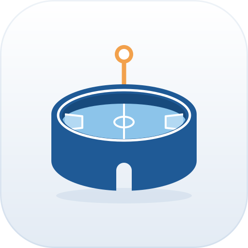
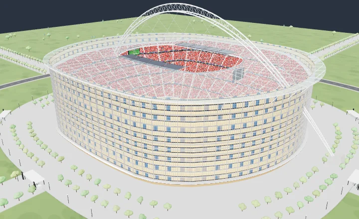
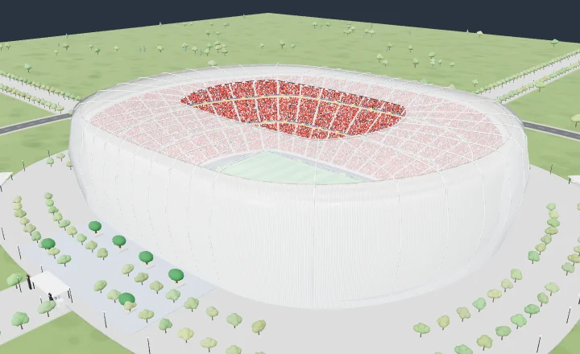
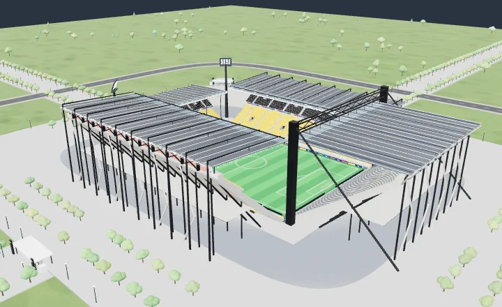
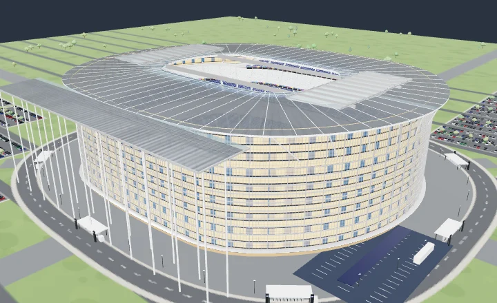
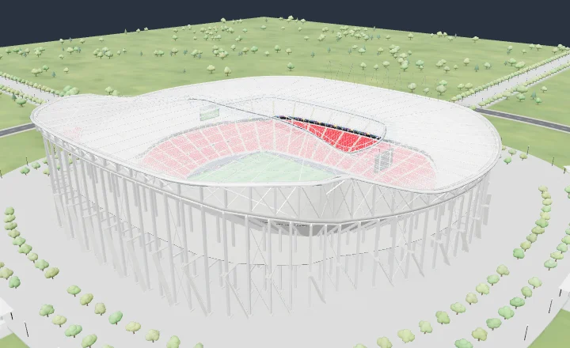
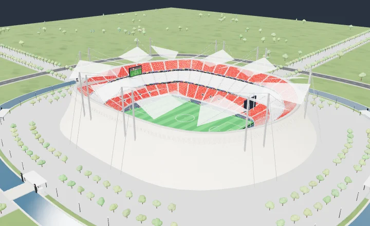
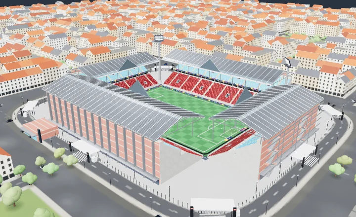

<div align="center">



# StadiumForge

**Dessinez un stade de football en 3D, directement dans le navigateur.**

Formes d'enceinte, tribunes, toitures et façades se règlent à la souris ; la maquette, la capacité
et les lignes de vue se recalculent à chaque geste.

[](https://florentfougeres.github.io/StadiumBuilder/)
[](.github/workflows/deploy.yml)


<br />



</div>

---

## Pourquoi

Esquisser un stade demande d'habitude un logiciel de CAO et beaucoup de temps. StadiumForge part
de l'inverse : on choisit une morphologie, on tire des curseurs, et l'outil garde le résultat
**constructible** — pentes de gradins aux normes, lignes de vue vérifiées, joints de dilatation,
raccords d'angles, ossature et toiture cohérentes. Tout tourne dans le navigateur, sans serveur
ni compte.

## Galerie

Quelques-uns des **38 stades d'exemple** livrés avec l'éditeur :

<table>
  <tr>
    <td></td>
    <td></td>
    <td></td>
  </tr>
  <tr>
    <td align="center"><sub>Coque lumineuse · 75 000</sub></td>
    <td align="center"><sub>Kop à l'anglaise · 48 000</sub></td>
    <td align="center"><sub>Toit rétractable · 88 000</sub></td>
  </tr>
  <tr>
    <td></td>
    <td></td>
    <td></td>
  </tr>
  <tr>
    <td align="center"><sub>Roue de câbles · 68 000</sub></td>
    <td align="center"><sub>Moucharabieh · 44 000</sub></td>
    <td align="center"><sub>Pignon historique · 24 000</sub></td>
  </tr>
</table>

## Fonctionnalités

| | |
| --- | --- |
| 🏟️ **16 formes d'enceinte** | Bol continu, chaudron, fer à cheval, arène octogonale, quatre tribunes à l'anglaise, ovale avec piste d'athlétisme, bol en selle, ovale de cricket… |
| 🪜 **Tribunes paramétriques** | 1 à 5 niveaux par tribune, rangs, pente constante ou progressive, coursives, loges vitrées, tribune de presse, places debout. Chaque tribune se règle seule ou toutes à la fois. |
| 📐 **Gradins aux normes** | Pente plafonnée à 35°, valeur C ≥ 90 mm, étages hauts reculés automatiquement si le balcon masque le terrain. |
| 🏗️ **44 systèmes de toiture** | Porte-à-faux, arche géante, roue de vélo, résille tendue, coques, dômes, toits rétractables, mâts haubanés, charpente bois… Toiture globale ou par tribune. |
| 🧱 **Façades et ossature** | 9 enveloppes (mur-rideau, lames, moucharabieh, arcades, rampes hélicoïdales…), cages d'escalier, coursive extérieure, joints de dilatation, accès véhicules dans les coins. |
| 📊 **Indicateurs en direct** | Capacité, lignes de vue (valeur C), emprise, hauteur maximale et coût estimé. |
| 🎥 **Caméras et rendu** | Vol en drone (ZQSD), vue depuis un siège, bord terrain, coupe 3D, plan 2D ; ciel physique jour, crépuscule ou nuit. |
| 💾 **Projets et exports** | Sauvegarde automatique locale, annuler / rétablir, export PNG, rendu photoréaliste par lancer de rayons, plan PDF, projet JSON et maquette GLB. |

## Démarrer

Prérequis : [Node.js](https://nodejs.org/) 20 ou plus récent.

```bash
git clone git@github.com:florentfougeres/StadiumBuilder.git
cd StadiumBuilder
npm install
npm run dev
```

L'éditeur s'ouvre sur <http://localhost:3000>.

| Commande          | Rôle                                         |
| ----------------- | -------------------------------------------- |
| `npm run dev`     | Serveur de développement avec rechargement   |
| `npm run build`   | Build de production dans `dist/`             |
| `npm run preview` | Sert le build de production localement       |
| `npm run lint`    | Vérification des types TypeScript            |
| `npm test`        | Tests unitaires du moteur de génération      |

## Sous le capot

React 19, TypeScript, Vite, Three.js, Zustand, Dexie (IndexedDB), Tailwind CSS, jsPDF et Vitest.
L'application est 100 % statique : aucun serveur ni clé d'API.

```
src/
├── stadium/   moteur paramétrique : schéma, préréglages, génération 3D
│              (tribunes, toits, façades, coins), capacité, lignes de vue
├── editor/    interface : viewport 3D, inspecteur, barre d'outils, projets
├── export/    exports PNG, PDF et GLB
└── state/     store Zustand, historique, persistance IndexedDB
```

Pour aller plus loin : [`PRODUCT.md`](PRODUCT.md) (vision produit), [`DESIGN.md`](DESIGN.md)
(charte de l'interface) et [`docs/ROADMAP.md`](docs/ROADMAP.md).

## Déploiement

Chaque push sur `main` lance [`deploy.yml`](.github/workflows/deploy.yml) : vérification des types,
tests, build puis publication sur GitHub Pages.

Réglage à faire une seule fois : **Settings → Pages → Build and deployment → Source : GitHub
Actions**.
